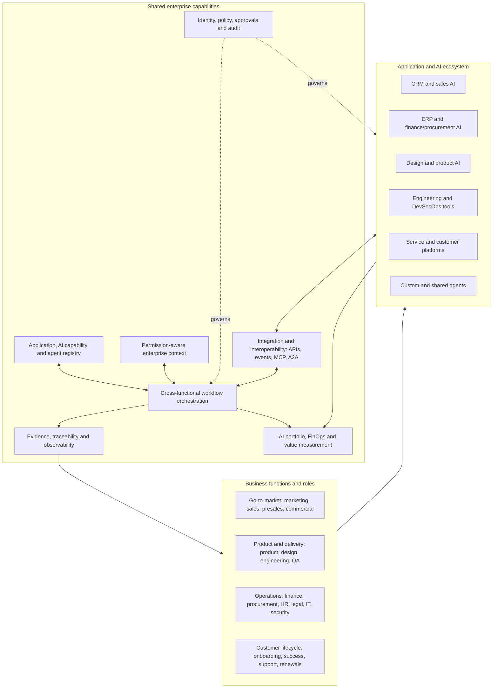

# Open Enterprise Agentic Architecture

> An open, modular reference architecture for connecting people, business processes, enterprise applications, AI capabilities and agents—while preserving local team autonomy and enterprise-wide visibility, governance and economic control.

**Status:** Research and architecture definition  
**Project type:** Open-source reference architecture and, over time, deployable reference implementations  
**Initial demonstration:** Customer request → commercial assessment → product decision → design and engineering → customer delivery and support

## Why this project exists

Organizations are adopting AI in many places at once: CRM, ERP, design tools, engineering environments, customer support, analytics and custom agent platforms. These capabilities often operate in separate application and departmental silos.

The opportunity is not to replace every application or build one universal agent. It is to define and demonstrate the connective architecture that lets specialized applications, agents and people participate in cross-functional business processes with appropriate context, permissions, evidence and cost visibility.

## Vision

Enable organizations to become connected, AI-enabled enterprises without requiring them to replace existing business applications, standardize on one model vendor, or sacrifice security, accountability and economic discipline.

## Core proposition

**Federated execution. Shared governance. Interoperable workflows. Traceable outcomes.**

- Departments retain ownership of their business applications and specialist AI capabilities.
- Teams can select fit-for-purpose native, shared, custom or conventional automation capabilities.
- Cross-functional workflows coordinate work across organizational and application boundaries.
- Enterprise policies govern identity, authorization, data access, human decisions and risk.
- Evidence connects business intent to execution, cost, delivery and business outcomes.

## First golden path

A customer asks Sales for a new capability. The request is evaluated commercially and financially, shaped by Product, designed, implemented through an AI-enabled SDLC, tested, approved, delivered, supported and connected to billing or renewal processes where appropriate.

See [the golden-path specification](docs/GOLDEN_PATH.md).

## What this project is—and is not

### It is

- A reference architecture, vocabulary and set of reusable patterns.
- A way to connect enterprise applications, native AI, custom agents and people.
- A foundation for governance, interoperability, AI FinOps, traceability and observability.
- A set of deployable examples that prove selected architecture patterns.

### It is not

- A replacement for Salesforce, SAP, Figma, Jira, GitHub, ServiceNow or other systems of record.
- A new foundation model or universal coding agent.
- A promise of fully autonomous business operations.
- A requirement to route all AI usage through one model provider or one runtime.
- A mandate to use AI where deterministic software or a human process is more appropriate.

## Architecture at a glance

The diagram is conceptual. It does not prescribe a specific vendor, deployment topology or technology stack.

## Initial architecture domains

1. **Business operating model:** capabilities, roles, decision rights and value streams.
2. **Workflow orchestration:** cross-functional processes, state, events, dependencies and human gates.
3. **Application and AI capability registry:** business applications, native AI features, agents, models, connectors, ownership and commercial terms.
4. **Agent execution:** agent definitions, runtimes, tools, isolation and execution policies.
5. **Integration and interoperability:** APIs, events, MCP, A2A and application adapters.
6. **Enterprise context:** permission-aware access to business and technical knowledge with provenance.
7. **Trust and governance:** identity, delegated authorization, approvals, policy, audit and risk controls.
8. **AI FinOps:** subscriptions, seats, credits, token/API usage, infrastructure cost, allocation and value.
9. **Evidence and observability:** lifecycle traceability, execution history, quality, costs and business outcomes.

## Design principles

See [Architecture Principles](docs/ARCHITECTURE_PRINCIPLES.md). The current principles are:

- Federated execution; shared governance and visibility.
- Preserve systems of record; integrate rather than replace.
- Prefer open interfaces and replaceable adapters.
- Use the least autonomy necessary for a task.
- Keep humans accountable for consequential business decisions.
- Separate probabilistic reasoning from deterministic enforcement.
- Make provenance and evidence first-class.
- Measure cost and value at the workflow/outcome level, not only token level.
- Support incremental adoption; avoid a mandatory big-bang platform.
- Use AI only where it creates a measurable advantage.

## Project status and roadmap

This project is in **Phase 0: research and architecture definition**. No implementation technology has been selected as a binding standard.

See [Roadmap](docs/ROADMAP.md) for the proposed phases. Near-term outputs are a business capability map, reference architecture, golden-path workflow, canonical data concepts and a validated technology assessment.

## How to contribute

We welcome feedback from enterprise architects, product leaders, engineering leaders, security professionals, FinOps practitioners, business application specialists and open-source maintainers.

- Open a discussion for architectural questions or competing approaches.
- Open an issue for a proposed capability, gap, integration or correction.
- Submit a pull request for documentation, diagrams, schemas or implementation examples.
- Please distinguish facts, implementation observations and hypotheses. Add sources for claims about existing tools or standards.

See [CONTRIBUTING.md](CONTRIBUTING.md).

## Research and references

The initial research register is in [docs/research/REFERENCE_LANDSCAPE.md](docs/research/REFERENCE_LANDSCAPE.md). It identifies adjacent projects and standards to reuse or evaluate. It is not an endorsement or a claim that the listed tools are the only viable options.

## License

Apache License 2.0. See [LICENSE](LICENSE).
